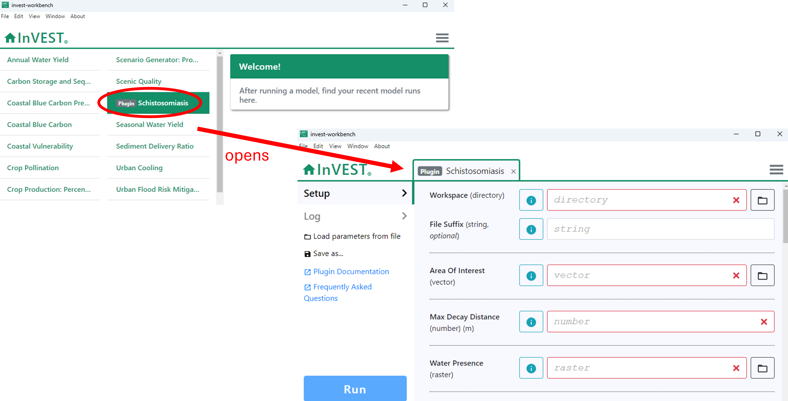
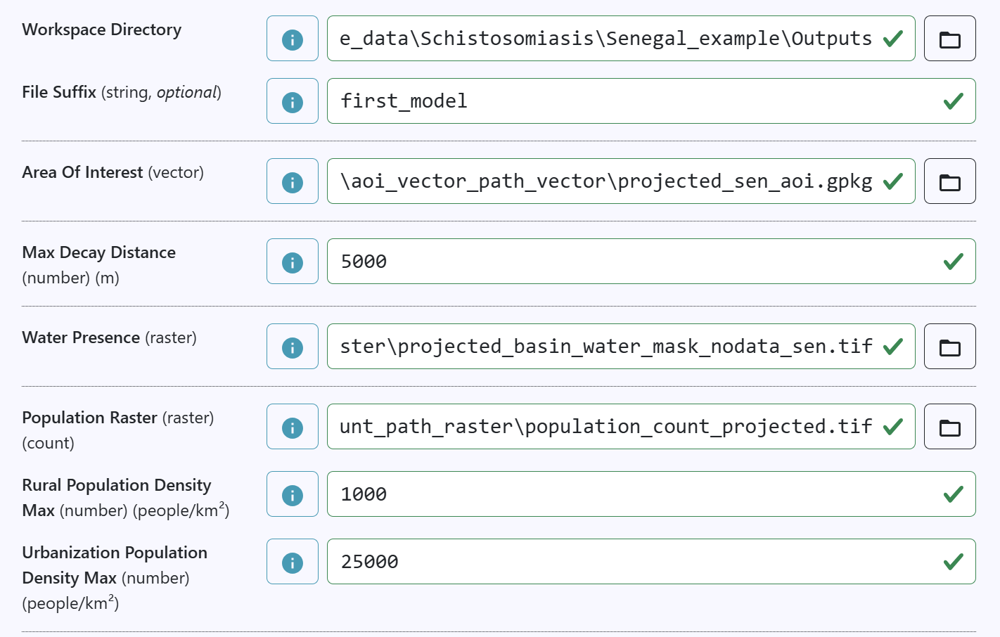
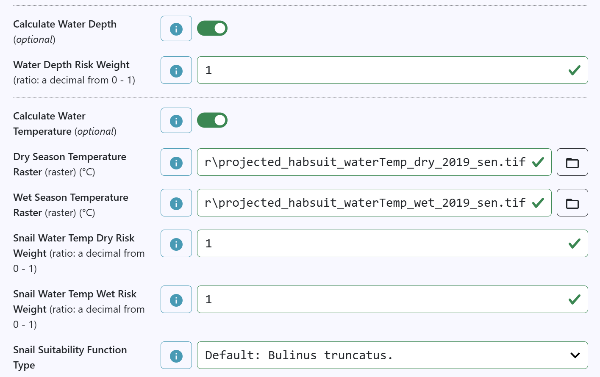
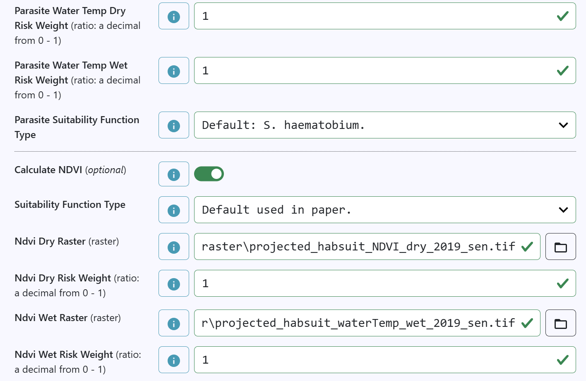
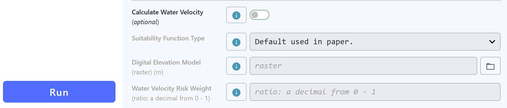

## Downloading sample data

Now that InVEST Workbench and the Schistosomiasis Plug-in are installed,
you will need sample data to run the model. We have provided sample data
for Cote d'Ivoire (CIV), Senegal, and Tanzania.

Zipped files containing the sample data can be downloaded from a Google
Drive folder linked
[here](https://drive.google.com/drive/folders/1lVnXvhtyNA9mAIwBPTD0HgFQELPkHs0V).
[currently need to ask for access!]{style="color: red;"}. For each
location, there are two files:

1.  `invest_schistosomiasis_[location]_datastack.tar.gz` contain InVEST
    datastack archives (a zipped tarball containing all model inputs and
    parameters). The data in these files will populate the inputs for
    the Schistosomiasis Tool.\
2.  `[location]_inputs.zip` contain all the inputs for each location,
    including the different AOI (Area of Interest - the geographic
    boundary defining the study region)
3.  Download the two Senegal files.
4.  Extract (unzip) the files and store them in a folder relevant to
    your project (e.g. `InVEST_schistosomiasis/Senegal_tutorial`)\
    {width="600"}

Note on folder set up. The structure that will be used in this tutorial
is:

```{r}
# -- InVEST_schistosomiasis  
#     |-- Scenario name (e.g., Senegal)  
#          |-- Inputs  
#               |-- the extracted spatial files go here  
#          |-- Outputs  
#               |-- this folder will fill with the model outputs  
```

## Running the model

1.  Open `InVEST` and then click `Schistosomiasis` to open the plugin.\
    
2.  The `Outputs` folder created above is the `Workspace (directory)`.
    Type the full folder path there or navigate to it using the folder
    icon.\
3.  `File suffix` will be appended to the file names of all the outputs.
    While optional, if you plan on doing multiple runs and saving them
    to the same folder this is necessary to update for each run so that
    files are not overwritten and results stay organized.
4.  For each input either paste the full directory (e.g.
    `C:/.../Inputs/invest_schistosomiasis_senegal_datastack/data/aoi_vector_path_vector/projected_sen_aoi.gpkg`
    where `...` is the full directory to the Inputs folder) OR use the
    folder icon to navigate to the files. The example files are clearly
    labeled for each file input.
    - vector files end in `.shp` or `.gpkg`
    - raster files end in `.tif`
5.  Parameter inputs. See the next tutorial for more details on what
    these mean. For now input:
    - `Max Decay Distance (m)`: 5000\
    - `Rural population density max (number) (people/km²)`: 1000
    - `Urbanization population density max (number) (people/km²)`: 25000
6.  Toggle on
    - `Calculate water depth`
      - Ratio = 1
    - `Calculate water temperature`
      - add respective wet and dry season air temperature rasters
      - Ratios = 1
      - Snail suitability function type: `Default: Bulinus truncatus`
      - Parasite suitability function type: `Default: S. haematobium`
    - `Calculate NDVI`
      - Suitability function type = `Default used in paper`
      - add respective wet and dry season air temperature rasters
      - Ratios = 1
7.  `Calculate water velocity` stays toggled to off.
8.  Click [Run]{.btn .btn-primary .btn-sm role="button"}

{width="50%"} 
{width="50%"} 
{width="50%"} 
{width="70%"}

## Viewing results

The model outputs many different estimates as `.tif` files. These can be opened in any geospatial software. [Additionally, we are developing a "report" that will generate automatically with each model run.]{style="color: red;"}  

The three main outputs to understand are habitat suitability, exposure risk, and estimated population at risk. 
```{r}
#| echo: false
#| message: false
#| warning: false
#| fig-height: 3


library(terra)
library(ggplot2)
library(tidyterra)
library(patchwork)

set_theme(theme_bw())

fp <- "G:/My Drive/De Leo Lab/projects/InVEST_schisto/InVEST_sample_data/Schistosomiasis/Senegal_example/Outputs/"

suit <- rast(paste0(fp, "habitat_suit_weighted_mean_first_model.tif"))
conv <- rast(paste0(fp, "convolved_hab_risk_first_model.tif"))
poprisk <- rast(paste0(fp, "risk_to_pop_count_abs_first_model.tif"))

conv <- mask(conv, poprisk)

r <- c(suit, conv, poprisk)
names(r) <- c("Habitat suitability\nsnails and parasites", "Habitat risk given\nwater distance", "Population risk given\npop. density")

p1 <- ggplot()+
  geom_spatraster(data = r[[1]]) +
  facet_wrap(~lyr) +
  scale_fill_continuous(na.value = "white", palette = "plasma")
p2 <- ggplot()+
  geom_spatraster(data = r[[2]]) +
  facet_wrap(~lyr) +
  scale_fill_continuous(na.value = "transparent", palette = "plasma")
p3 <- ggplot()+
  geom_spatraster(data = r[[3]]) +
  facet_wrap(~lyr) +
  scale_fill_continuous(na.value = "transparent", palette = "plasma")

p1 + p2 + p3 & 
  theme(legend.position = "none",
        legend.title = element_blank(),
          axis.text = element_text(size=6),
        axis.text.x = element_text(angle = 90))
```


